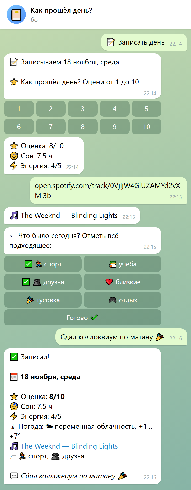
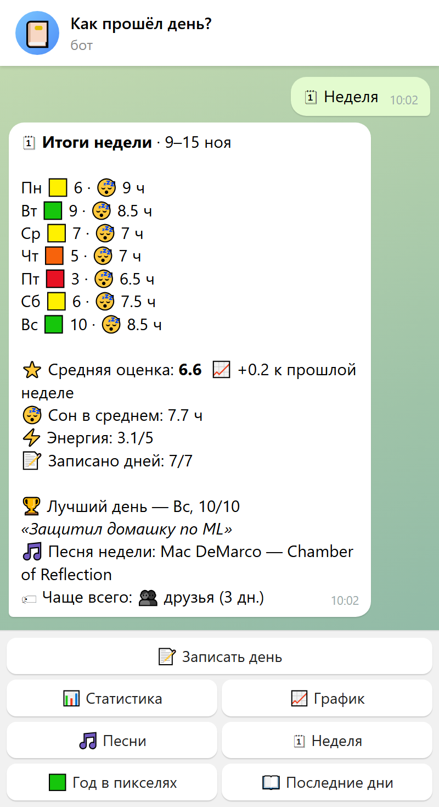
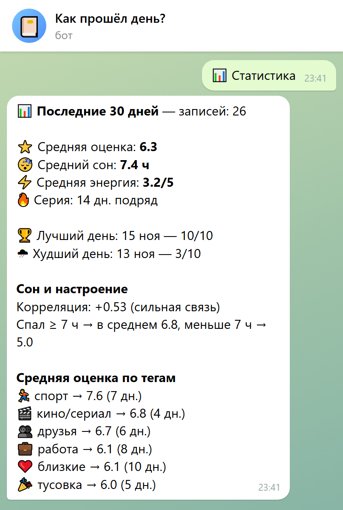
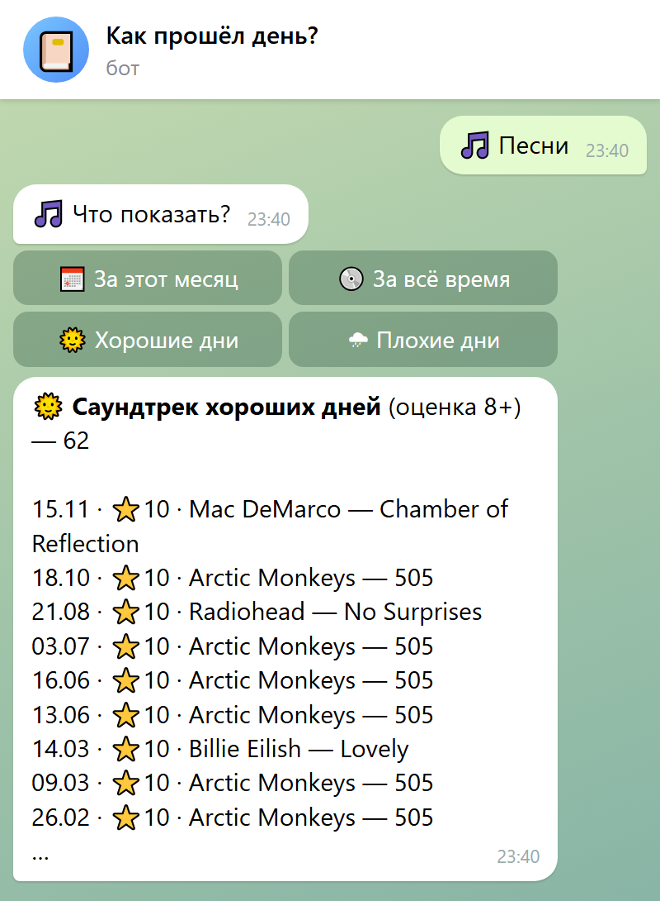
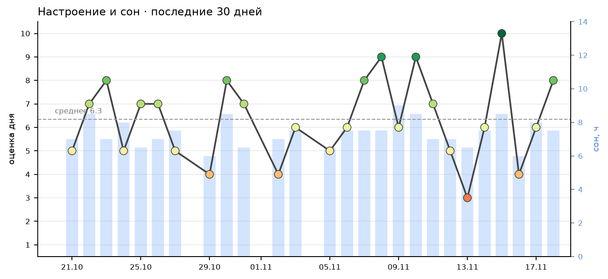
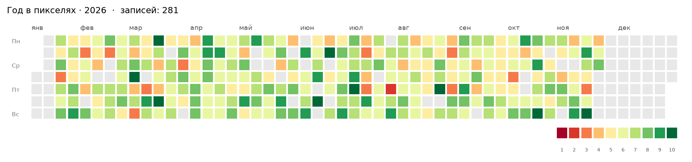

# 📔 «Как прошёл день?» — Telegram-бот-дневник

Бот: **@kak_proshel_den_bot**. Работает в облаке круглосуточно, ноутбук не нужен.

Каждый вечер (~22:00 МСК) бот спрашивает, как прошёл день:
⭐ оценка 1–10 · 😴 сон · ⚡ энергия 1–5 · 🎵 песня (ссылка Spotify или название) · 🏷 теги · 💬 главное за день · 🌡 погода (сама)

## Как это выглядит

| Запись дня | Итоги недели | Статистика | Песни |
|:---:|:---:|:---:|:---:|
|  |  |  |  |

**График настроения и сна** (`/chart`)



**Год в пикселях** (`/pixels`) — каждая клетка — день, цвет — оценка



<sub>Картинки сгенерированы настоящим кодом бота на демо-данных (`python scripts/make_screenshots.py`) — реальные записи дневника не публикуются.</sub>

## Стек
Python 3.12 · Telegram Bot API (вебхуки) · Vercel Serverless Functions + Cron · Neon Postgres · matplotlib · Open-Meteo, iTunes Search, Spotify oEmbed

## Команды
| | |
|---|---|
| `/day` или «📝 Записать день» | записать день (до 5 утра пишется во вчерашний) |
| `/stats` | статистика за 30 дней: средние, сон ↔ оценка, теги |
| `/chart` | график оценки дня и сна за 30 дней |
| `/songs` | песни за месяц, за всё время, саундтрек хороших (8+) и плохих (≤4) дней |
| `/week` | итоги недели (в понедельник ~10:00 приходят сами) |
| `/pixels` | год в пикселях |
| `/history` | последние 7 дней (у каждой карточки — «✏️ Исправить» / «🗑 Удалить») |
| `/edit`, `/edit 15.11`, `/edit вчера` | исправить прошлый день по полям (оценка, сон, энергия, песня, теги, заметка) или дописать пропущенный |
| `/delete`, `/delete 15.11` | удалить запись за день (с подтверждением) |
| `/remind on` / `/remind off` | вечерние напоминания вкл/выкл |
| `/export` | все записи в CSV (для pandas / Excel) |
| `/cancel` | отменить текущую запись |

## Как это устроено
```
Телефон → Telegram → Vercel (api/webhook.py, Франкфурт) → база Neon Postgres (diary-db, Франкфурт)
                     Vercel Cron → api/cron.py: напоминание 19:00 UTC, итоги недели пн 07:00 UTC
```
- `api/webhook.py` — сюда Telegram присылает каждое сообщение (проверяется секретный заголовок)
- `api/cron.py` — расписание + `?task=setup` (переподключить бота к Telegram)
- `app/bot.py` — вся логика диалога; шаг записи хранится в таблице `drafts`
- `app/storage.py` — Postgres в облаке (`DATABASE_URL`), SQLite локально для тестов
- `app/stats.py` — статистика, графики, песни, итоги недели
- `app/extras.py` — погода (Open-Meteo), песни (iTunes, Spotify)
- `old_local/` — первая версия, которая работала только на ноутбуке (больше не нужна)

## Обновление бота
Репозиторий подключён к Vercel: каждый `git push` в ветку `main` автоматически собирает и выкладывает
новую версию (~1 минута). Откатить неудачную версию: Vercel → Deployments → нужная версия → *Promote to Production*.

## Настройки в Vercel (проект `kak-proshel-den-bot`, команда temka3)
- `BOT_TOKEN` — токен от @BotFather
- `DATABASE_URL` — подставляется автоматически интеграцией Neon

**Если поменял токен** (`/revoke` у BotFather): обнови `BOT_TOKEN` в Vercel → Redeploy → открой
`https://kak-proshel-den-bot.vercel.app/api/cron?task=setup` — бот переподключится.
